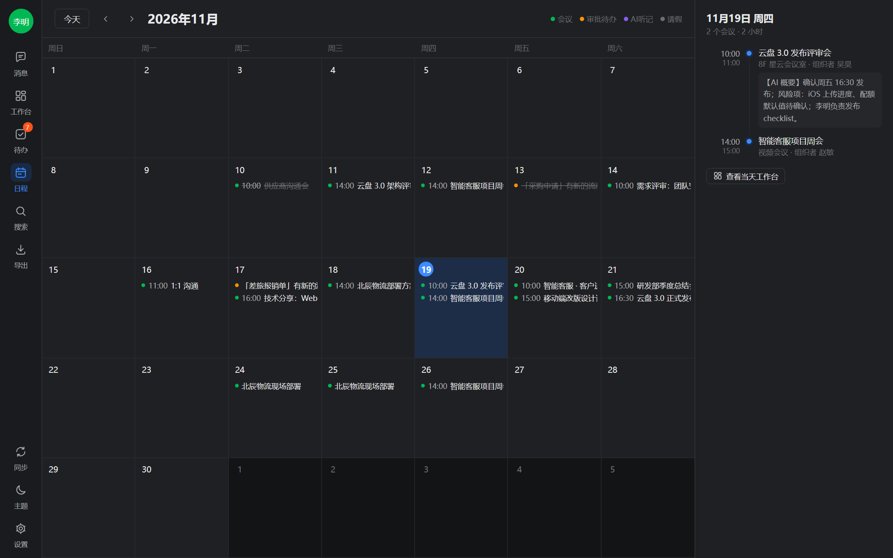
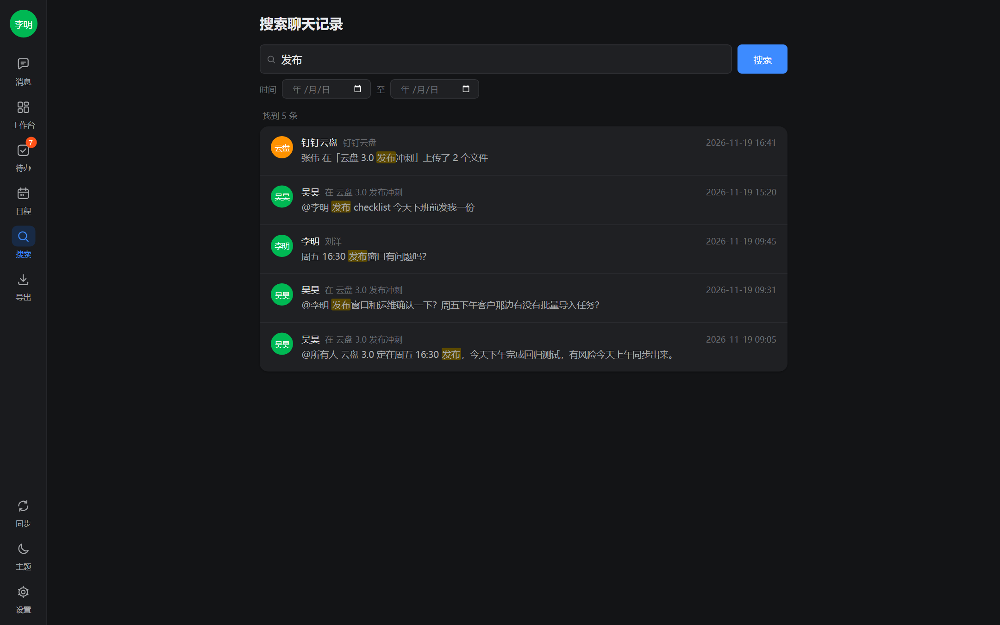

# dingtalk-agent

> 让 AI Agent 读懂你的钉钉：本地解密钉钉桌面版聊天记录与日程，提供 **网页 + REST API + MCP**，
> 用于每日工作总结、互动统计、项目跟踪，并自动整理待办和待跟踪事项。

*Decrypt your own DingTalk desktop (V2/V3) chat history and calendar locally, browse it in an embedded web UI,
and expose it to AI agents via REST and MCP for daily summaries and auto-generated to-dos.*

- **单文件，零依赖**：一个可执行文件，网页已内嵌；纯 Go 实现（含 SQLite），不需要 Python、CGO 或第三方解密工具
- **原生解密，支持 V2 / V3**：AES-ECB，正确处理 WAL；聊天记录和日历一次完整解密约 2 秒
- **内置 AI 助手**：接入 DeepSeek、通义千问、Kimi、智谱、OpenAI 或本机 Ollama 等兼容 OpenAI 接口的模型，每天自动生成日报、周报，提取待办、跟踪进展、安排第二天的工作；也可以直接和 AI 对话，@ 某人或某群来分析、讨论和处理工作
- **为 Agent 设计**：结构化日报统计、按重要程度排序的消息摘要、日程，以及可写回的总结和待办
- **数据只在本机**：只读访问钉钉数据；默认只监听 `127.0.0.1`，并拦截跨站和 DNS rebinding 访问；对外的网络请求只有两种：检查 GitHub 上的新版本（可关闭），以及你启用内置 AI 助手后访问你配置的模型接口

## 功能

| 模块 | 说明 |
|---|---|
| 消息 | 浏览全部单聊、群聊和项目群，支持图片（优先显示原图，可缩放）、文件、引用、富文本和 @ 高亮 |
| AI 对话 | 和 AI 讨论你的工作：可以 @ 某人或某群，AI 会结合他们的聊天记录回答，也能自己查找消息、日程和待办，帮你分析、起草回复、记下待办 |
| 工作台 | 每日统计（消息量、互动的人、参与的群和项目、会议、待我回复）、AI 日报和周报（可一键生成）、日程时间线、@我的消息 |
| 待办 | AI 提取或手动添加的待办（todo）与待跟踪（follow_up）事项，支持优先级、截止日期，可跳回来源会话；AI 判断已完成的事项会提示你确认 |
| 日程 | 钉钉日历月视图：会议、会议室、组织者、审批待办、AI 听记、请假 |
| 搜索 | 全量关键字搜索，可限定会话和时间范围 |
| 导出 | 按会话导出 JSON（含图片和文件附件），便于交给 AI 分析 |
| 设置 | AI 助手（模型接口、自动生成时间）、自动同步频率、Agent 接入信息、检查更新 |
| 桌面窗口 | Windows 上双击即以独立窗口打开（无需浏览器），关闭窗口后缩到托盘继续运行 |
| 自动升级 | 发现 GitHub 上的新版本时提示，确认后自动下载、校验、替换并重启 |
| Agent 接口 | REST API 和 MCP（HTTP / stdio），提供 12 个工具和 2 个提示词模板 |

支持浅色和深色主题（默认跟随系统）。

## 截图

> 截图使用虚构的演示数据，人物、公司和聊天内容均为虚构。

**消息**：会话列表与聊天记录，支持图片、文件、引用和 @ 高亮（深色主题）


**工作台**：每日统计、AI 日报与重点关注、日程、待办（浅色主题）


<table>
  <tr>
    <td width="50%"><b>待办</b>：AI 提取的待办与待跟踪事项<br></td>
    <td width="50%"><b>日程</b>：钉钉日历月视图<br></td>
  </tr>
  <tr>
    <td width="50%"><b>搜索</b>：全量聊天记录关键字搜索<br></td>
    <td width="50%"><b>设置</b>：同步频率与 Agent 接入信息<br></td>
  </tr>
</table>

## 环境要求

- **钉钉桌面版**：需要至少登录过一次，支持两种账号数据目录：
  - 新版 `<hash>_v3`：密钥由数字 UID 和 `user_config` 中的 salt 派生
  - 旧版 `<uid>_v2`：目录名就是 UID，密钥为 `md5(uid)`
- **数据目录位置**：
  - Windows：`%APPDATA%\DingTalk\`
  - macOS：`~/Library/Containers/<TeamID>.com.dingtalk.mac/Data/Library/Application Support/DingTalkMac/`
- **操作系统**：Windows 和 macOS（均已测试）。Linux 也会尝试查找钉钉数据目录，但尚未测试

## 快速开始

从 [Releases](https://github.com/qqshow/dingtalk-agent/releases) 下载对应平台的文件：

| 平台 | 文件 |
|---|---|
| Windows（x64） | `dingtalk-agent-windows-amd64.zip` |
| Windows（ARM） | `dingtalk-agent-windows-arm64.zip` |
| macOS（Apple 芯片） | `dingtalk-agent-darwin-arm64.tar.gz` |
| macOS（Intel） | `dingtalk-agent-darwin-amd64.tar.gz` |

也可以用 Go 安装（需要 Go 1.26+）：`go install github.com/qqshow/dingtalk-agent@latest`

### Windows

解压 zip，**双击 `dingtalk-agent.exe`** 即可。程序以独立窗口打开（使用系统自带的 WebView2，不需要浏览器），
任务栏右下角的托盘里会出现程序图标：

- **关闭窗口**：程序缩到托盘继续运行，定时同步和 AI 日报 / 周报照常进行
- **单击托盘图标**：重新打开窗口；右键菜单可以「在浏览器中打开」或「退出」
- **再次双击 exe**：不会重复启动，而是把已有的窗口切到前台
- 窗口大小和位置会被记住

从命令行（cmd / PowerShell / Windows Terminal）运行 `.\dingtalk-agent.exe` 时，则在终端里运行，不打开窗口，
用浏览器访问 <http://localhost:8090>。想让它在后台运行、不要窗口和托盘图标，可以在快捷方式里加 `-no-window` 参数
（这时没有任何界面，用浏览器访问，退出要在任务管理器里结束进程）。

电脑上没有 WebView2 时（Win11 和已更新 Edge 的 Win10 都自带），程序会自动改用默认浏览器打开页面。

### macOS

1. 解压，并去掉浏览器下载时附加的隔离标记（程序没有 Apple 签名，不去掉会被系统拦截）：

   ```bash
   tar -xzf dingtalk-agent-darwin-arm64.tar.gz
   cd dingtalk-agent-darwin-arm64
   xattr -d com.apple.quarantine dingtalk-agent
   ```

2. 给终端授予「完全磁盘访问权限」。钉钉的数据在它自己的沙盒容器里，macOS 默认不允许其他程序读取：

   打开 **系统设置 → 隐私与安全性 → 完全磁盘访问权限**，添加并打开你使用的终端（终端、iTerm 等），然后**完全退出并重新打开终端**。

3. 运行：

   ```bash
   ./dingtalk-agent
   ```

4. 打开 <http://localhost:8090>

如果启动时提示 `no DingTalk V3 account found`，通常是第 2 步的权限没有生效。可以用下面的命令确认，能列出目录就说明权限正常：

```bash
ls ~/Library/Containers/*com.dingtalk.mac/Data
```

通过 Claude Code 以 stdio 方式启动 MCP 时，读取权限同样来自运行 Claude Code 的那个终端。

### 首次启动

首次启动时，程序会自动查找钉钉账号目录，从钉钉客户端日志中识别你的数字 UID（并用数据库文件头验证），然后完成解密。
之后默认每 30 分钟自动同步一次，可在网页的 **设置** 页修改。

### 命令行

```
dingtalk-agent [serve]                    启动网页 + REST API + MCP(HTTP)，默认命令
dingtalk-agent mcp                        以 stdio 方式运行 MCP server
dingtalk-agent sync                       立即解密一次
dingtalk-agent report -date yesterday     输出某天的结构化统计（JSON）
dingtalk-agent digest -date today         输出某天的消息摘要（Markdown），-scope involved 只看与我相关的
dingtalk-agent digest -from 2026-11-16 -to 2026-11-20    一段时间的摘要
dingtalk-agent prompt -date today         输出推荐的每日总结提示词
```

> Windows 版是窗口程序（这样双击时不会闪出黑色的控制台窗口）。在 cmd / PowerShell 里直接运行时，输出照常显示在当前终端，
> 但终端不会等它结束，命令提示符可能先出现、输出跟在后面，按一下回车即可。需要等它结束（例如在脚本里）时，
> 用 `start /wait dingtalk-agent.exe report` 或在 PowerShell 里加 `| Out-Host`；重定向到文件（`> report.json`）和管道不受影响。
> Agent 通过 stdio 运行 `dingtalk-agent mcp` 也不受影响。

| 参数 | 默认值 | 说明 |
|---|---|---|
| `-port` | `8090` | 监听端口 |
| `-host` | `127.0.0.1` | 监听地址。设为 `0.0.0.0` 会把聊天记录暴露到局域网，请谨慎 |
| `-sync-interval` | `30` | 自动同步间隔（分钟，`0` 表示关闭）。指定后会覆盖网页上的设置 |
| `-uid` | 自动识别 | 钉钉数字 UID |
| `-no-window` | | Windows 上双击启动时不打开窗口和托盘图标，只在后台运行 |
| `-dingtalk-dir` | 自动查找 | 账号目录，以 `<hash>_v3` 或 `<uid>_v2` 结尾 |
| `-data` | `<程序目录>/data` | 本地数据目录 |

以上设置也可以写在 `data/config.json`（首次运行时自动生成）：

```json
{
  "uid": "123456789",
  "dingtalk_dir": "C:\\Users\\<you>\\AppData\\Roaming\\DingTalk\\<hash>_v3",
  "port": 8090,
  "sync_interval_minutes": 30
}
```

## 内置 AI 助手

不想另外装 Agent？在网页的 **设置 → AI 助手** 中填入模型接口即可：

| 服务商 | 接口地址 |
|---|---|
| DeepSeek | `https://api.deepseek.com/v1` |
| 通义千问（阿里云百炼） | `https://dashscope.aliyuncs.com/compatible-mode/v1` |
| Kimi（月之暗面） | `https://api.moonshot.cn/v1` |
| 智谱 GLM | `https://open.bigmodel.cn/api/paas/v4` |
| OpenAI | `https://api.openai.com/v1` |
| Ollama（本机） | `http://localhost:11434/v1`，不需要 API Key |

其他兼容 OpenAI `/chat/completions` 接口的服务同样可以使用。填好接口地址、模型名和 API Key 后，点"测试连接"确认可用，再启用。

**它会做什么**

- **日报**：每天在设定时间（默认 18:30）自动生成，也可以在工作台随时点"生成日报"。内容包括今日概览、会议结论、项目进展、需要重点关注的事、我今天做了什么，以及结合明日日程和待办截止日期的**明日安排**
- **待办**：从聊天中提取新的待办和待跟踪事项，写入待办列表（重复的事项不会重复创建）
- **跟踪进展**：对照当天聊天判断现有事项是否已完成或不再需要。AI 只给建议，在待办页面由你确认后才会生效
- **周报**：每周固定一天（默认周五）在同一时间生成，根据本周日报、事项变化和下周日程写成，不会重新发送一周的聊天记录

如果程序在设定时间没有运行，当天稍后启动时会补上。如果当天已有其他 Agent（如 Claude Code）写入的日报，自动任务不会覆盖它。

**AI 对话**（左侧栏"AI 对话"）

- 直接提问，例如"总结今天的工作""最近一周我答应过别人、但还没完成的事情有哪些？""结合明天的日程帮我安排工作"
- 把聊天记录当知识库：问"之前「数据库连接超时」是怎么解决的？""「某项目」的来龙去脉""谁熟悉「某技术」""之前有人发过「某文档」吗"。
  AI 会在全部历史中换几个关键词搜索，再读相关会话的前后消息，按问题、原因、解决办法、处理人、时间整理，并注明出处
- 输入 `@` 选择某人或某群，时间范围可选今天、近 3 天、近 7 天或近 30 天：
  - 选择人：会附上你和他的单聊记录，以及他在群里的发言。没有单聊过的同事也能选到（标为"群成员"），会附上他在群里的发言和群里 @ 他的消息
  - 选择群：会附上群里的聊天记录
- AI 会按需查阅数据：按名称查找会话、读取某个会话的消息、搜索关键字、查看统计、日程和待办，每一步都会显示在回答上方
- 可以让 AI 起草回复（复制后自己在钉钉里发送），或让它把讨论出的事项记成待办
- 在消息页面打开某个会话，点右上角"问 AI"，会直接 @ 这个人或群开始对话
- 对话记录保存在本地 `data/agent.db`，可以随时回看或删除

查阅数据依赖模型的工具调用（function calling）能力。DeepSeek、通义千问、Kimi、智谱、OpenAI 的主流模型都支持；
如果模型不支持，AI 会根据你 @ 的人或群的聊天记录回答；问题中用「」括起来的关键词会先在全部历史中搜索，把结果一起交给 AI。回答中会有提示。

**隐私**：生成日报时，只把与你相关的聊天发给模型服务商：单聊、你发过言或被 @ 的群、项目群；其他群只发送统计数字，机器人消息不发送。
周报只使用已生成的日报和事项。AI 对话中，你 @ 的人或群的聊天记录，以及 AI 为回答问题查阅的内容，会发送给模型服务商。
想让数据完全不离开电脑，请使用本机的 Ollama。

API Key 保存在 `data/config.json` 中，也可以用环境变量 `DINGTALK_AI_API_KEY` 提供，这种方式不会写入文件。
发送给模型的聊天摘要默认最多 30000 字，可以在 `config.json` 的 `ai.max_input_chars` 中调整。

## 接入外部 AI Agent

### Claude Code

二选一：

```bash
# A. 连接已在运行的服务（HTTP）
claude mcp add --transport http dingtalk http://localhost:8090/mcp

# B. 由 Claude Code 直接启动（stdio，不依赖服务是否在运行）
claude mcp add dingtalk -- /path/to/dingtalk-agent mcp
```

然后在 Claude Code 中运行提示词模板：

```
/mcp__dingtalk__daily_summary                         # 今天的日报，并自动写入待办和待跟踪事项
/mcp__dingtalk__daily_summary yesterday
/mcp__dingtalk__weekly_summary 2026-11-16 2026-11-20  # 周报
```

生成的日报和待办会保存到本地，在网页的 **工作台** 和 **待办** 页面可以看到。

**每天自动运行**：可以用系统计划任务执行
`claude -p "/mcp__dingtalk__daily_summary today" --allowedTools "mcp__dingtalk__*"`，
也可以在 Claude Code 里用 `/schedule` 创建定时任务。

其他支持 MCP 的客户端（如 Claude Desktop）同样可以接入：HTTP 地址填 `http://localhost:8090/mcp`，或用 stdio 方式运行 `dingtalk-agent mcp`。

### MCP 工具

| 工具 | 作用 |
|---|---|
| `dingtalk_daily_report` | 某天或某段时间的统计：消息量、互动的人、参与的群和项目、@我、等待我回复、日程 |
| `dingtalk_daily_digest` | 按会话分组、按重要程度排序的消息全文（Markdown），用于大模型总结 |
| `dingtalk_get_messages` | 读取单个会话在某段时间内的全部消息 |
| `dingtalk_calendar` | 日程：会议（时间、会议室、组织者、是否回复邀请、备注）、审批待办、AI 听记、请假 |
| `dingtalk_search` | 关键字搜索 |
| `dingtalk_list_conversations` | 会话列表 |
| `dingtalk_sync` | 立即同步 |
| `dingtalk_save_summary` / `dingtalk_get_summary` | 保存 / 读取日报 |
| `dingtalk_add_todos` / `dingtalk_list_todos` / `dingtalk_update_todo` | 待办和待跟踪事项；重复写入同一事项只会更新内容，不会重复创建，也不会重新打开已完成的事项 |

提示词模板（MCP prompts）：`daily_summary`、`weekly_summary`。

### REST API

适用于任意 Agent 或脚本，接口说明可访问 `GET /api/agent` 查看。

- 日期参数：`YYYY-MM-DD`、`today`、`yesterday` 或 `-N`（N 天前）
- 时间区间用 `from`、`to`（都包含在内）
- 加上 `refresh=1` 时，如果数据已超过 5 分钟，会先同步再返回

```
POST   /api/agent/sync                       立即同步
GET    /api/agent/report?date=today          结构化统计
GET    /api/agent/digest?date=today&scope=all|involved&format=markdown|json
GET    /api/agent/messages?cid=<cid>&date=today
GET    /api/agent/calendar?from=2026-11-01&to=2026-11-30&include_closed=1
GET    /api/search?q=关键字&from=&to=&cid=
GET    /api/agent/summary?date=today
PUT    /api/agent/summary                    {"date":"2026-11-19","summary":"<markdown>","focus":["..."]}
GET    /api/agent/todos?status=open|done|dropped|all&kind=todo|follow_up
POST   /api/agent/todos                      {"items":[{"kind":"todo","title":"...","priority":"high","due":"2026-11-21"}]}
PATCH  /api/agent/todos/{id}                 {"status":"done"}
DELETE /api/agent/todos/{id}
GET    /api/settings
PUT    /api/settings                         {"sync_interval_minutes":10}
POST   /api/ai/run                           {"kind":"daily|weekly","date":"today"}  由内置 AI 生成日报 / 周报
POST   /api/chat/send                        {"session_id":0,"text":"...","mentions":["<cid>"],"days":7}  AI 对话（SSE 流式返回）
GET    /api/chat/sessions                    AI 对话列表；GET/PATCH/DELETE /api/chat/sessions/{id}
GET    /api/chat/people?q=王&no_chat=1       搜索联系人（用于 @），no_chat=1 只返回没有单聊的人；对话中用 "u:<uid>" 引用
GET    /api/ai/status                        内置 AI 的运行进度、上次结果和下次自动运行时间
```

## 统计口径

- **互动的人**：单聊中有往来的人，加上群里 @我 或被我 @ 的人；不包括机器人和系统账号（如钉钉云盘）
- **参与的群**：我在群里发过言，或被单独 @ 过（@所有人 不算）
- **项目群**：钉钉标记为项目群的群（`sceneGroupCode` / `tagCodes` 为 `project`）
- **等待我回复**：单聊最后一条消息来自对方、我之后没有回复；或在群里被单独 @ 后，我没有在该群发言
- **会议**：钉钉日历中未取消的会议；请假（考勤）单独标记，不计入会议时长
- 系统提示（如"xx 发起了群聊"）不计入"我发送的消息"

## 常见问题

**提示无法确定 UID？**
程序会从钉钉日志（Windows 为 `%APPDATA%\DingTalk\log\`，macOS 为 `DingTalkMac/log/`）中查找 UID。如果日志已被清理，可以在日志里搜索 `real_uid=` 找到自己的数字 UID，
再通过 `-uid` 参数或 `data/config.json` 指定。注意：V3 账号目录名中的那串字符是哈希值，不是 UID；V2 账号目录名中的数字就是 UID，会被自动使用。

**电脑上登录过多个钉钉账号？**
程序默认选择最近有更新的那个账号（`*_v3` 或 `*_v2`）。要指定其他账号，用 `-dingtalk-dir` 参数或在 `data/config.json` 中设置 `dingtalk_dir`。

**图片模糊，或标着"缩略图"？**
钉钉只会为你在客户端里点开看过的图片下载原图，其余图片本地只有 720px 的缩略图。在钉钉中点开那张图片，再点一次"同步"即可看到原图。

**同步是增量的吗？**
不是。每次都是从钉钉客户端完整解密一次（约 2 秒，不影响钉钉使用），所以同步频率设得高一些也没有问题。

**能看到会议的参会人或 AI 听记内容吗？**
不能。钉钉本地只缓存了会议的组织者；AI 听记正文保存在服务器上。部分会议的备注中带有 AI 概要，这部分会被读取。

**会修改钉钉的数据吗？**
不会。程序只读取钉钉的数据库文件，解密后的副本保存在 `data/decrypted/`，Agent 写回的内容保存在独立的 `data/agent.db`。

**窗口关掉了，程序还在运行吗？**
在。关闭窗口只是缩到托盘，定时同步和 AI 日报 / 周报会继续。要完全退出，右键托盘图标选「退出」。
Windows 11 默认会把新的托盘图标收起来，点任务栏右下角的 `^` 可以找到，也可以把它拖到任务栏上常驻。

**想开机自动启动？**
按 `Win + R` 输入 `shell:startup` 打开启动文件夹，把 `dingtalk-agent.exe` 的快捷方式放进去即可。

**怎么升级？**
程序启动时和每隔 12 小时会检查 GitHub 上的新版本。有新版本时，网页右下角会提示，点"立即升级"后自动完成：
下载对应系统的安装包，用发布页的 `SHA256SUMS.txt` 校验，确认新程序可以正常运行后替换旧程序，再自动重启，页面随后自动刷新。
任何一步失败都会保留原来的程序。也可以在 **设置 → 关于** 中手动检查更新，或关闭自动检查。
自己从源码编译的版本（版本号显示为 `dev`）不会提示升级。
如果程序放在没有写权限的目录（如 `C:\Program Files`），自动升级会失败，请手动下载替换。

## 数据目录

```
data/
  config.json        账号、端口、同步频率、AI 助手、是否自动检查更新（自动生成）
  window.json        窗口大小和位置（Windows 窗口模式）
  webview/           窗口内嵌浏览器（WebView2）的缓存
  decrypted/         解密后的快照（每次同步生成新文件，旧文件自动清理）
  agent.db           日报、周报和待办，建议备份
  ai_state.json      AI 助手的自动运行记录
  exports/           导出的 JSON 和附件
  sync_state.json    同步状态
  logs/              运行日志
```

`data/` 中包含解密后的聊天记录，请妥善保管，不要提交到代码仓库或分享给他人（`.gitignore` 已默认排除）。

## 隐私与免责声明

- 本项目仅用于**在你自己的电脑上读取你自己的钉钉数据**。请勿用于获取他人数据。
- 聊天记录可能包含同事、客户的个人信息和公司机密。使用前请确认符合所在组织的数据安全规定；
  启用内置 AI 助手或将数据交给其他云端 AI 服务前，请评估其中的敏感信息。
- 本项目与钉钉、阿里巴巴无任何关联。"钉钉"及相关标识归其各自所有者所有。
- 钉钉客户端更新可能导致数据格式变化、解密失效。本软件按"原样"提供，不提供任何担保。

## 开发

需要 Go 1.26 或更高版本。

```bash
git clone https://github.com/qqshow/dingtalk-agent.git
cd dingtalk-agent
go build -ldflags "-s -w -H windowsgui" -o dingtalk-agent.exe .   # Windows（窗口程序，双击不闪控制台）
go build -ldflags "-s -w" -o dingtalk-agent .                      # Linux / macOS
go test ./...
```

Windows 程序的图标和版本信息来自根目录的 `rsrc_windows_*.syso`（`go build` 会自动带上）。更换图标 `internal/desktop/icon.ico` 后重新生成：

```bash
go run github.com/tc-hib/go-winres@v0.3.3 simply --arch amd64,arm64 --out rsrc --icon internal/desktop/icon.ico --manifest gui
```

推送到 `main` 或提交 PR 时，GitHub Actions 会运行测试并构建 Windows 和 macOS 程序；推送 `v*` 标签会自动发布 Release。

项目结构：

```
main.go                 命令行入口
internal/
  config/   配置、账号目录发现、UID 识别
  decrypt/  V2 / V3 数据库解密（聊天记录与日历）
  store/    快照管理、消息解析、查询、日程
  analysis/ 日报统计、消息摘要、日程汇总
  agentdb/  Agent 写回的日报和待办
  ai/       内置 AI 助手（OpenAI 兼容接口、工具调用、日报 / 周报生成、定时任务）
  chat/     AI 对话（@ 人或群、调用数据工具）
  syncer/   定时同步与状态
  update/   检查新版本与自动升级
  desktop/  Windows 桌面窗口（WebView2）和托盘图标
  export/   JSON 导出与 zip 打包
  web/      HTTP 服务、REST API、内嵌前端（static/，原生 JS，无构建步骤）
  mcp/      MCP server（工具与提示词，支持 stdio / HTTP）
```

欢迎提交 Issue 和 PR。提交 Issue 时，请不要附带真实的聊天内容、UID 或截图中的个人信息。

## 致谢与许可

- V3 解密算法与 UID 识别方法移植自 [idealistichacker/dingtalk-chat-exporter](https://github.com/idealistichacker/dingtalk-chat-exporter)（MIT），详见 [THIRD_PARTY_NOTICES.md](THIRD_PARTY_NOTICES.md)
- V2 密钥派生方式参考了 [p1g3/dingwave](https://github.com/p1g3/dingwave)
- 感谢 [LINUX DO](https://linux.do) 社区的交流与支持
- 本项目以 [MIT License](LICENSE) 发布
